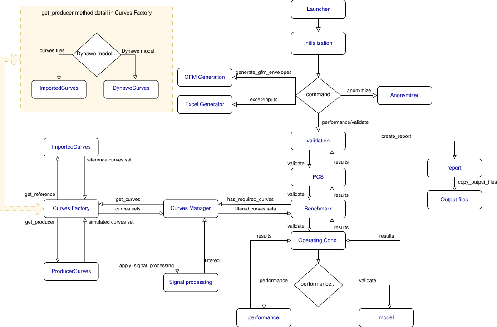

# Developer setup

This document explains how to set up a **DyCoV development environment**
from source.

It is intended for **developers and contributors** who want to:
- modify DyCoV,
- debug internal behavior,
- add or extend features,
- contribute changes to the codebase.

If you only want to **use DyCoV**, do **not** follow this document.
Refer instead to the installation guides in `docs/installation/`.

---

## 1. Scope and assumptions

This document describes a **native Linux development workflow**.

Assumptions:
- You are working on a Linux system.
- You are comfortable with command‑line tools.
- You understand Python virtual environments at a basic level.

End‑user installation methods (distribution image, WSL, Docker end‑user mode)
are **not suitable for development workflows**.

---

## 2. System requirements

### 2.1 Operating system

A recent Linux distribution is required.

Recommended:
- Debian 12 or newer
- Ubuntu 22.04 LTS or newer

---

### 2.2 System packages

Install the required system tools:

```bash
sudo apt install \
  git \
  curl \
  unzip \
  make
```

`make` builds the Sphinx manuals and compiles the PDF reports at runtime;
`curl` and `unzip` fetch and unpack the components.

---

### 2.3 LaTeX

DyCoV generates PDF reports, which are often needed during development.

```bash
sudo apt install \
  texlive-base \
  texlive-latex-base \
  texlive-latex-recommended \
  texlive-latex-extra \
  texlive-science \
  texlive-lang-french \
  latexmk \
  dvisvgm
```

---

### 2.4 Python (3.13 or 3.14)

DyCoV runs on **Python 3.13 and Python 3.14**. CI builds and tests both.

Ensure one of them is installed and available:

```bash
python3.13 --version
```

If several Python versions are installed, pass the one you want explicitly when
creating the development environment.

---

### 2.5 uv

DyCoV uses **uv** to manage virtual environments and dependencies.

Install uv:

```bash
curl -LsSf https://astral.sh/uv/install.sh | sh
```

> **Note**
>
> `pip` and `venv` are not used directly.
> All dependency management is handled by `uv`.

---

## 3. Dynawo requirement (developer responsibility)

DyCoV relies on **Dynawo** to run RMS simulations.

In a **development context**:
- Dynawo is **not installed or managed by DyCoV**.
- Installing and maintaining Dynawo is the **responsibility of the developer**.  
  If Dynawo is missing or misconfigured, workflows relying on RMS simulations will fail at runtime.

In practice, developers usually work with a **Dynawo nightly distribution**,
as this is the reference used for ongoing developments and for alignment with
current model and feature support.

You may:
- use a precompiled Dynawo distribution (for example, a nightly build), or
- clone the Dynawo repository and build it yourself from source.

The choice depends on your development needs and constraints.

For instructions on installing or compiling Dynawo, refer to the **official
Dynawo documentation**.

Developers must ensure that:
- a compatible Dynawo version is available,
- the `dynawo.sh` launcher can be found (for example via `PATH` or an explicit
  configuration).

DyCoV does not enforce a specific Dynawo installation method in development mode.

### Using Dynawo without modifying PATH

It is **not mandatory** to add Dynawo to the system `PATH`.

If the Dynawo launcher (`dynawo.sh`) is **not available in PATH**, the developer
must explicitly provide its location when running DyCoV, using the
`-l` / `--launcher` command‑line option.

For example:

```bash
dycov validate -l /path/to/dynawo/dynawo.sh ...
```

---

## 4. Cloning the repository

Choose a working directory and clone the DyCoV repository:

```bash
git clone https://github.com/dynawo/dyn-grid-compliance-verification dycov_repo
cd dycov_repo
```

The repository declares a custom merge driver for the reference curves of the
examples (`.gitattributes` maps `examples/**/*.csv` to it). Register it once
per clone:

```bash
bash scripts/setup-git-hooks.sh
```

---

## 5. Creating the development environment

Create a virtual environment. This guide uses Python 3.13; Python 3.14 works
the same way:

```bash
uv venv dycov_venv --python 3.13
```

Activate the environment (from the project root):

```bash
source dycov_venv/bin/activate
```

---

## 6. Installing DyCoV in development mode

Install DyCoV in editable mode with development dependencies:

```bash
uv pip install -e .[dev,test]
```

This installs:

*   DyCoV itself in editable mode,
*   all runtime dependencies,
*   development and test dependencies.

---

## 7. Running DyCoV in development mode

With the virtual environment activated, verify that DyCoV is available:

```bash
dycov --version
```

Commands executed in this environment:

*   use the local source tree,
*   reflect code changes immediately.

The build script also installs the bash completion of `dycov` into the
environment, so activating it completes commands, options and paths with
`TAB`. The completion script is generated from the CLI parsers; after adding
or modifying a command, regenerate it with:

```bash
bash installers/install_bash_completion.sh "$PWD/dycov_venv"
```

---

## 8. Quality checks, tests and documentation

The commands below are run from the repository root with the virtual
environment activated. They are the checks CI runs on every pull request.

### 8.1 Linting and formatting

**ruff** handles both, configured in `pyproject.toml` (line length 99, rules
`E`, `F`, `W` and `I`):

```bash
ruff check src tests            # lint
ruff format --check src tests   # formatting, as CI verifies it
ruff format src tests           # formatting, applied
```

### 8.2 Tests

The unit tests live under `tests/`, mirroring the `src/dycov/` layout, and run
with **pytest**; `pytest.ini` already points it at that directory:

```bash
pytest                          # the whole unit test suite
pytest tests/dycov/model        # a single subtree
pytest --cov=src                # with coverage
```

`tests/README.md` states the style every new test must follow. Coverage is
informational: there is no coverage gate.

The end-to-end tests under `tests_integration/` are not part of that run. They
execute real Dynawo simulations, so they need a working Dynawo installation
and take far longer. Run them explicitly:

```bash
pytest tests_integration
```

### 8.3 Building the manuals

Both Sphinx manuals are built with `make`, from their own directory:

```bash
cd docs/manual        # user manual
make html             # -> build/html/index.html
make latexpdf         # -> build/latex/dycov.pdf

cd ../manual_dev      # developer manual
make html             # -> build/html/index.html
make latexpdf         # -> build/latex/dycov-dev.pdf
```

The PDF targets need the LaTeX packages of section 2.3. The user manual's
`Makefile` runs `helps.py` before Sphinx, so its CLI reference pages are
regenerated from the installed version of the tool.

### 8.4 Unattended runs: the `--testing` flag

When `dycov validate` or `dycov performance` finishes, it opens the report it
has just generated in the system viewer, whenever a display is available. That
is convenient interactively, but it blocks any unattended run — a full example
execution, a before/after comparison — on the first report it produces.

Both commands accept `--testing`, which suppresses it:

```bash
dycov validate --testing -l /path/to/dynawo/dynawo.sh ...
```

The flag is declared with `argparse.SUPPRESS`, so it does not show up in
`--help`. It is meant for developers and is deliberately absent from the user
documentation.

---

## 9. Typical development workflow

A common development loop is:

1.  Activate the environment:
    ```bash
    source dycov_venv/bin/activate
    ```
2.  Modify source files under `src/dycov/`.
3.  Ensure Dynawo is correctly configured and reachable.
4.  Run DyCoV commands against one of the bundled examples.
5.  Inspect logs, generated results, and reports.
6.  Run the checks of section 8 before committing: `pytest` and `ruff`.
7.  Iterate.

---

## 10. When to use this setup

Use this development setup if you:

*   work on DyCoV internals,
*   need to debug execution logic,
*   add or modify workflows or PCS,
*   contribute changes to the codebase.

If your goal is only to run validations or generate reports,
use the installation methods described in `docs/installation/` instead.

---

## 11. DyCoV architecture overview

The diagram below provides a high-level view of the DyCoV execution flow.
It is intended to help developers understand the main components and their
relationships, not to document every internal detail.

> **Note**
> This diagram reflects the architecture at a given point in time.
> As DyCoV evolves, some details may become outdated.
> If you notice a significant discrepancy, updating the diagram is a welcome
> contribution.

